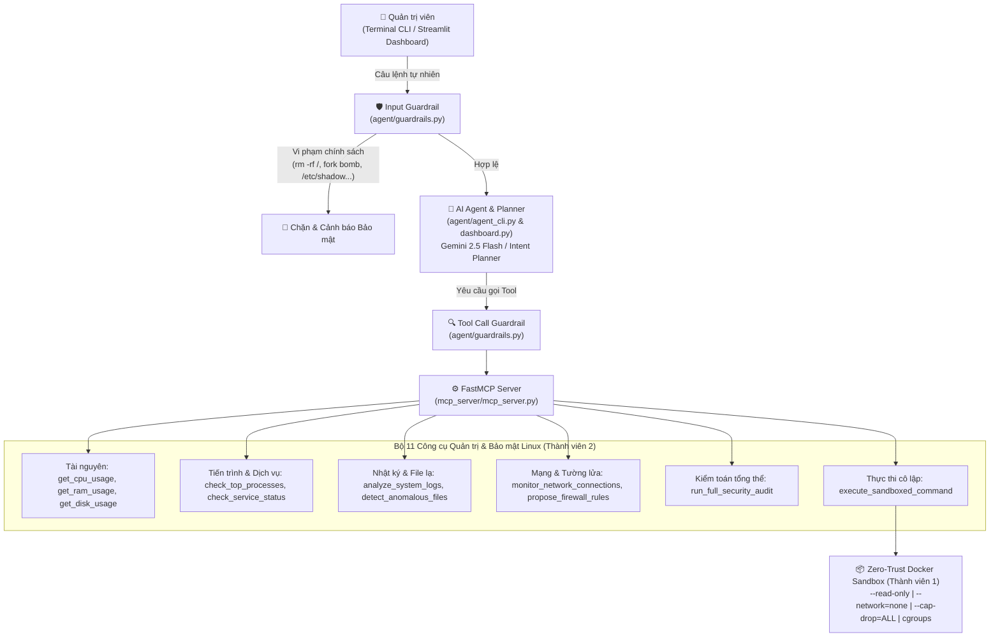

# Kiến trúc Hệ thống: Agentic AI System with MCP for Automated Linux Administration & Security Auditing

## 1. Sơ đồ Kiến trúc Tổng thể

## 2. Luồng Hoạt động (Workflow)
1. **Tiếp nhận yêu cầu**: Quản trị viên nhập câu lệnh tự nhiên qua **Terminal CLI** (`python3 agent/agent_cli.py`) hoặc **Streamlit Web Dashboard** (`streamlit run agent/dashboard.py`).
2. **Kiểm duyệt đầu vào (`Input Guardrail`)**: Kiểm tra câu lệnh có chứa mã độc, lệnh xóa hệ thống hoặc tấn công Prompt Injection hay không.
3. **Lập kế hoạch & Gọi công cụ (`MCP Tool Calling`)**: Agent xác định danh sách các MCP Tools cần gọi trên `FastMCP Server`.
4. **Thực thi an toàn (`System Tools & Zero-Trust Sandbox`)**:
   - Các công cụ giám sát đọc thông số trực tiếp từ hệ điều hành Linux.
   - Các câu lệnh shell tùy chỉnh bắt buộc đi qua `execute_sandboxed_command` để chạy bên trong container cô lập của Thành viên 1.
5. **Tổng hợp báo cáo**: Kết quả từ các MCP Tools được tổng hợp thành báo cáo Markdown kèm khuyến nghị cấu hình `ufw` / `iptables`.
